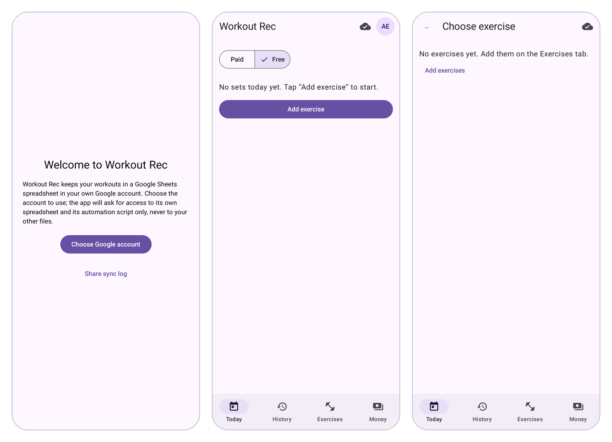
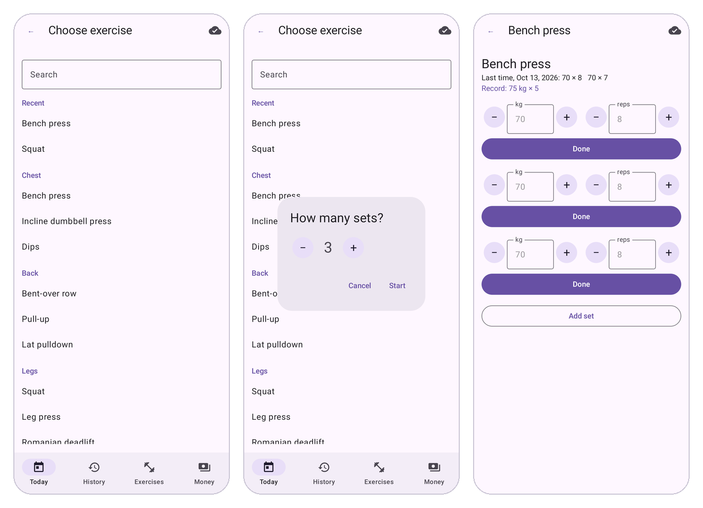
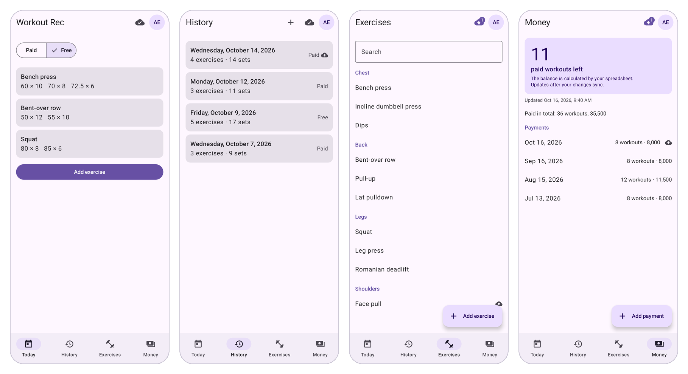
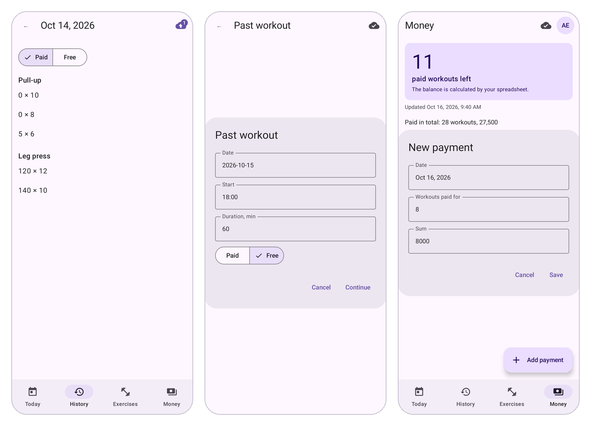
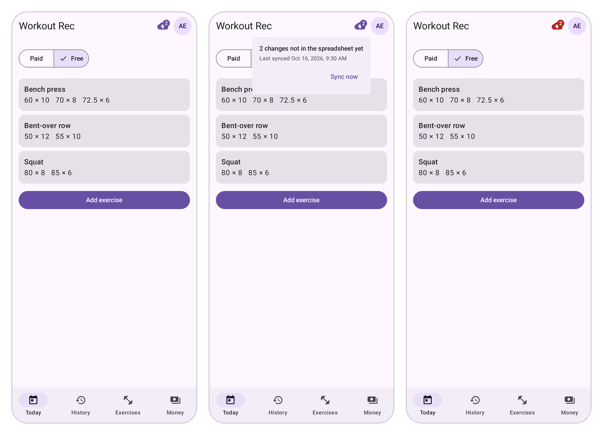
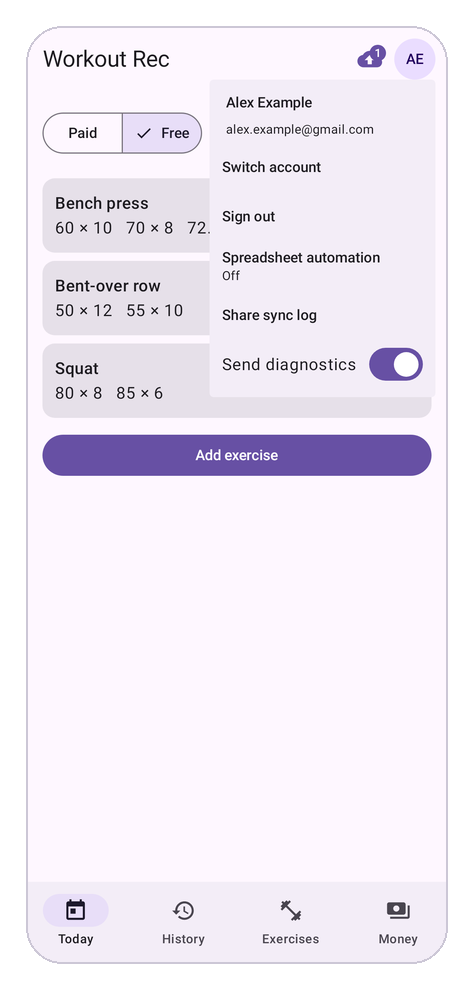
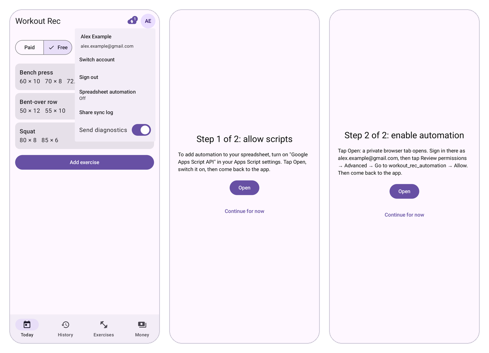

# Workout Rec: Getting Started

**English** · [Русский](README.ru.md) · For developers: [README_ENGINEERING.md](README_ENGINEERING.md)

Workout Rec is an Android app for writing down your gym sets in seconds, keeping every workout in a Google spreadsheet that belongs to you, and knowing how many prepaid coach sessions you have left.

## The idea

The app replaces the notebook or the spreadsheet you fill in between sets. Three ideas shape it:

- **Fast at the gym.** Pick an exercise, and the weight and reps from last time are already filled in. Most sets take one tap to record.
- **Your data stays yours.** Every set goes into an ordinary Google spreadsheet in your own Google Drive. There is no separate account and no company server holding your workouts. You can open, edit, chart or share that spreadsheet like any other.
- **Coach sessions counted for you.** If you prepay a coach for a number of sessions, mark each workout as paid (with the coach) or free (alone). The spreadsheet counts how many paid sessions you have left.

## How it fits together

There are three parts, and only one of them is the app:

1. **The app on your phone** is where you record sets, mark a day paid or free and add payments.
2. **Your spreadsheet** in Google Drive is the real home of your data. The app creates it for you on first run. It has tabs for the log of sets, your exercise list, payments, workout days and the balance. Its formulas work out each workout's length and how many paid sessions you have left as soon as anything changes.
3. **An optional nightly helper** can run inside your spreadsheet. You don't need it. Turn it on if you also want to keep your workouts in the spreadsheet without the app (see the last section).

You can also change things directly in the spreadsheet on a computer. The app picks those changes up the next time it syncs.

## Getting started

You need an Android phone (8.0 or newer) and a Google account. Joining the test takes one email to the app's owner; after that, setup takes about a minute.

1. **Ask to join the test.** The app is in a closed test on Google Play, so only listed accounts can install it and sign in. Email the app's owner at atotmakov.dev@gmail.com with the Gmail address you use for Google Play on your phone. The owner adds it to the testers list and to the accounts allowed to sign in, then replies that you are in.
2. **Become a tester.** On your phone, signed in to Google Play with that same account, open [play.google.com/apps/testing/com.workoutrec](https://play.google.com/apps/testing/com.workoutrec) and tap **Become a tester**. If the page says the app is not available, your address hasn't been added yet, or the phone uses another account.
3. **Install the app.** On the same page tap **download it on Google Play**, or search for Workout Rec in the Play Store, and install it. New versions arrive through Google Play like any other app. It can take a few hours after step 2 before Google Play shows the app.
4. **Choose your Google account** and allow access. Use the same account you gave the owner. The app can only see files it creates itself, not the rest of your Drive.
5. **Wait a few seconds** while the app creates your spreadsheet, named `workout_rec_database_`. Then you are on **Today**, ready to log.
6. **Add your exercises** on the **Exercises** tab: a muscle group and a name for each. If you tap **Add exercise** on Today before that, the app takes you there.

*From left: choosing your Google account, Today right after setup, and the prompt to add exercises.*

## Logging a workout

A typical set takes one tap: the weight and reps from your last time are already there.

1. On **Today**, tap **Add exercise** and pick one from your list.
2. Choose how many sets you plan to do.
3. For each set, check the weight and reps. They start from your previous workout and look gray until you change them. Use **−** and **+** to adjust: the weight moves by 0.5 kg, the reps by 1.
4. Confirm the set. It is saved at once and shows up on Today under that exercise.

*From left: pick an exercise, choose how many sets, confirm each set.*

Forgot to log a workout? In **History**, tap **+** to enter a past workout with its date, start time and length.

Made a mistake? Tap any set, today's or an older one, to change or delete it.

## The four tabs

The bar at the bottom of the screen has four tabs.

*From left: Today, History, Exercises and Money.*

| Tab | What you do there |
| --- | --- |
| Today | Record today's sets and switch the day between Paid and Free |
| History | See earlier workouts with their Paid or Free status, open a day to fix a set, add a forgotten workout |
| Exercises | Add, rename or delete exercises. A rename also updates every old set. An exercise you have already logged can't be deleted |
| Money | See how many paid sessions you have left, see your payments and add a new one |

## Paid or Free, and your balance

Each workout day is either **Paid** (with the coach, so it uses one prepaid session) or **Free** (on your own).

- **You rarely need to touch it.** A new day starts with the same choice as your previous workout, and your very first workout starts as Free.
- **Changing it:** use the Paid | Free switch on Today. For an earlier day, open it in History. Changing an old day never changes the days after it.
- **When you pay the coach,** add the payment on the **Money** tab.
- **The balance** on Money is the number of paid sessions left: your payments minus your paid days. Your spreadsheet calculates it, so it changes as soon as a payment or a changed day reaches the spreadsheet. While changes are still waiting to be copied, a note under it says "Updates after your changes sync." If it goes below zero, you owe sessions.

*From left: changing an earlier day, choosing Paid or Free for a forgotten workout, adding a payment.*

## No signal at the gym

The app works fully without internet. Everything you do is saved on the phone first and copied to your spreadsheet when the phone is online again, even if the app is closed by then.

The cloud icon at the top shows where things stand:

- **Cloud with a check mark:** everything is in your spreadsheet.
- **Cloud with an up arrow:** some changes are waiting to be copied. Tap the icon to see how many, or to copy them now.
- **A red cloud:** copying is not working, for example with no connection or when Google asks you to sign in again. Your sets are safe on the phone in the meantime.

*From left: two changes waiting, their details after tapping the cloud, and the red cloud when copying fails.*

## Good to know

- **Privacy.** The app reaches only the spreadsheet it created, and nothing else in your Google Drive. Your workouts are not stored anywhere else.
- **Editing on a computer.** You can change sets, exercises and payments right in the spreadsheet. If you change the same thing in both places, the spreadsheet's version wins and the app tells you so.
- **Error reports.** The app sends anonymous error reports to help fix problems. They contain no workout data. You can turn them off with **Send diagnostics** in the account menu (tap your initials at the top).
- **Another account.** You can switch Google accounts or sign out from the same menu. Before signing out, the app warns you if some sets haven't reached the spreadsheet yet.

*The account menu: Switch account, Sign out, Spreadsheet automation, Share sync log (for reporting a problem) and Send diagnostics.*

| Message | What it means |
| --- | --- |
| Sign in again to sync | Google wants you to confirm access. Tap it and allow |
| Can't sync: no connection | Your sets are safe on the phone and will be copied once you're online |
| …was changed in the spreadsheet… | The same item was edited in the spreadsheet too, and the spreadsheet's version was kept |
| Spreadsheet automation: Stopped | You turned automation on, but its nightly run hasn't happened lately. Tap Spreadsheet automation in the account menu to turn it on again. The balance and your sets are not affected |

## Working with workouts in Google Spreadsheet without app

Everything the app does also works in the spreadsheet alone, on a computer or in the Google Sheets app. Type sets in the **log** tab, exercises in **drills** and payments in **money**. The workout lengths and the balance are formulas, so they update as you type.

A few things the app normally does for you need a helper script in the spreadsheet when you work without the app:

- **A line for each new day** in the **workout** tab. The app adds it when it syncs; without the app, the script adds it every night. Without that line, a paid day is not counted in the balance.
- **The time of a set**, filled in when you type an exercise in **log**.
- **The rec tab** showing the sets of the exercise you select there.

The script is called spreadsheet automation. Turn it on once from the app: tap your initials at the top to open the account menu, then tap **Spreadsheet automation**. It takes two steps:

1. **Allow scripts (once per Google account).** Tap **Open**. A Google settings page opens: turn on **Google Apps Script API**, then come back to the app. If your account already allows scripts, this step is skipped.
2. **Enable automation (once per spreadsheet).** Tap **Open**. A private browser tab opens: sign in there with the same Google account, then tap **Review permissions**, **Advanced**, **Go to workout_rec_automation** and **Allow**. Google warns that it "hasn't verified this app". That is expected, because the helper is your own. Close the tab with the ✕ at the top to return to the app.

When it is on, the menu item reads "On". Tap **Continue for now** to leave either step for later.

*From left: the account menu with automation off, step 1 and step 2.*
