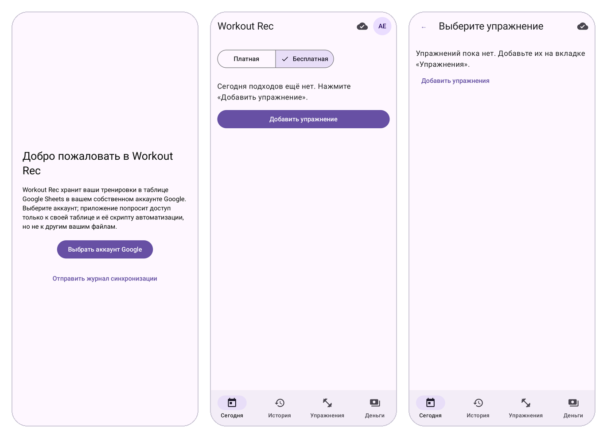
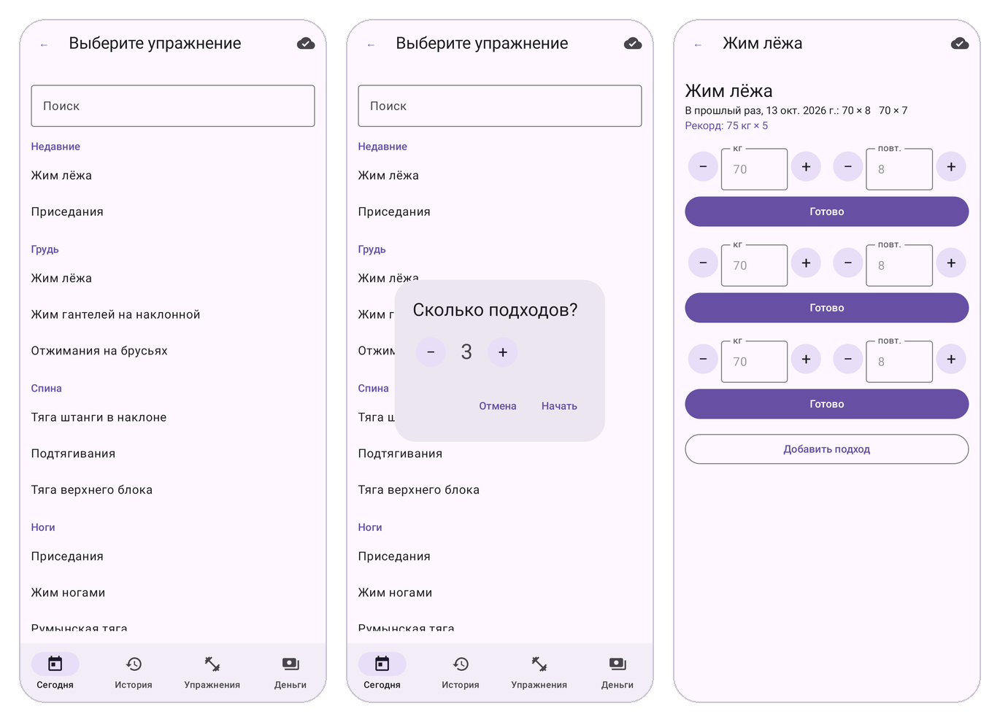
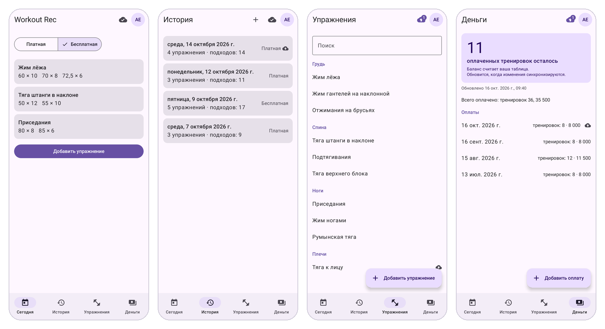
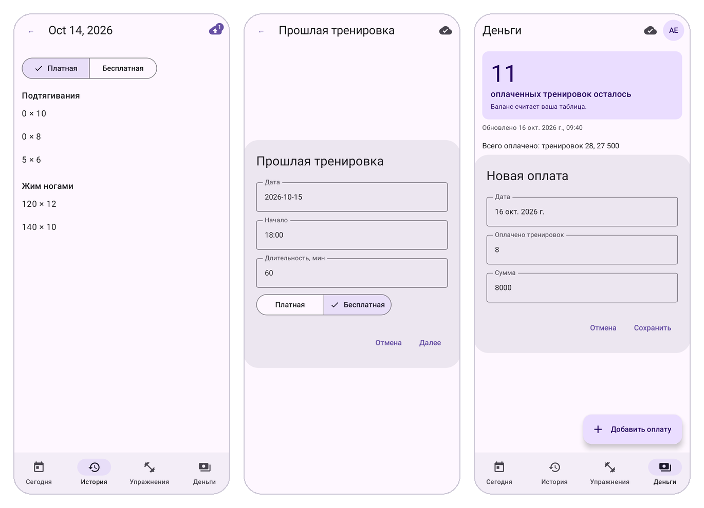
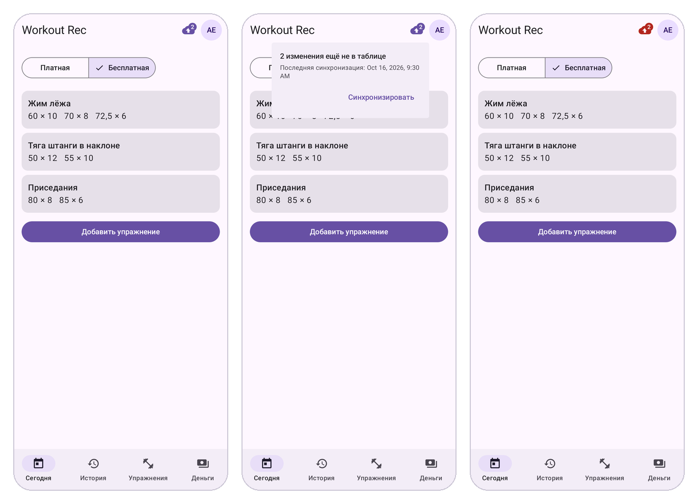
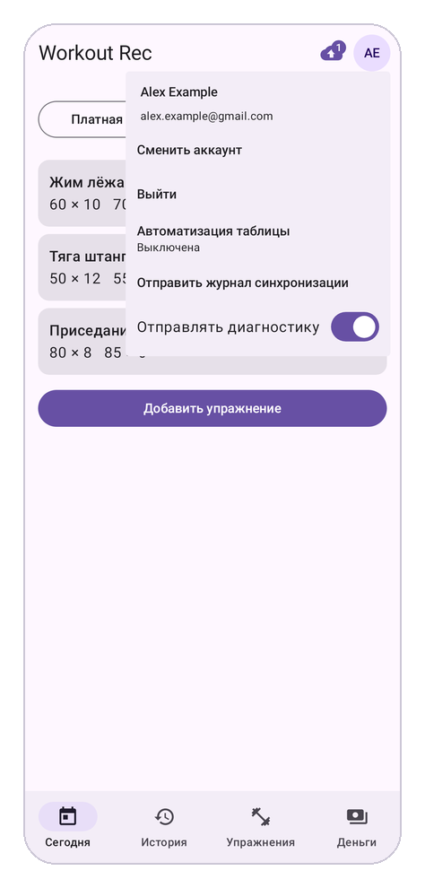
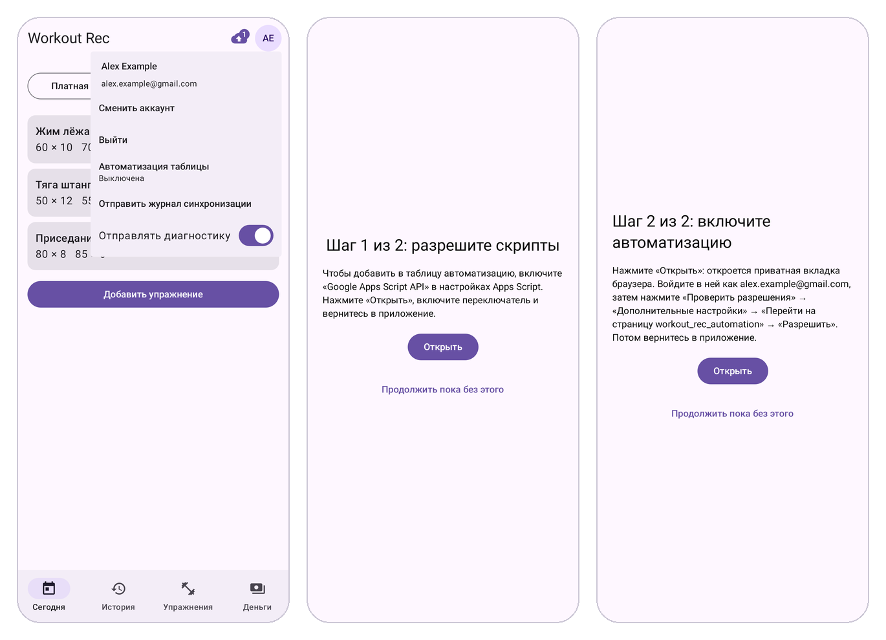

# Workout Rec: начало работы

[English](README.md) · **Русский** · Для разработчиков: [README_ENGINEERING.md](README_ENGINEERING.md)

Workout Rec — приложение для Android, чтобы за секунды записывать подходы в зале, хранить все тренировки в Google Таблице, которая принадлежит вам, и знать, сколько оплаченных занятий с тренером осталось.

## Идея

Приложение заменяет блокнот или таблицу, которую вы заполняете между подходами. В его основе три идеи:

- **Быстро в зале.** Выберите упражнение — вес и повторения с прошлого раза уже подставлены. Большинство подходов записывается одним нажатием.
- **Ваши данные остаются вашими.** Каждый подход попадает в обычную Google Таблицу на вашем Google Диске. Нет отдельной учётной записи и нет сервера компании, который хранит ваши тренировки. Таблицу можно открывать, править, строить по ней графики и делиться ею, как любой другой.
- **Занятия с тренером считаются за вас.** Если вы заранее оплачиваете тренеру несколько занятий, отмечайте каждую тренировку как платную (с тренером) или бесплатную (самостоятельно). Таблица посчитает, сколько оплаченных занятий осталось.

## Как всё устроено

Есть три части, и только одна из них — приложение:

1. **Приложение на телефоне** — здесь вы записываете подходы, отмечаете день как платный или бесплатный и добавляете оплаты.
2. **Ваша таблица** на Google Диске — настоящее место хранения данных. Приложение создаёт её при первом запуске. В ней есть вкладки для журнала подходов, списка упражнений, оплат, дней тренировок и баланса. Формулы в таблице сразу пересчитывают длительность каждой тренировки и число оставшихся оплаченных занятий, как только что-то меняется.
3. **Необязательный ночной помощник** может работать внутри таблицы. Он не нужен, если вы пользуетесь приложением. Включите его, если хотите вести тренировки в таблице и без приложения (см. последний раздел).

Менять данные можно и прямо в таблице на компьютере. Приложение подхватит эти изменения при следующей синхронизации.

## Начало работы

Нужны телефон на Android (8.0 или новее) и аккаунт Google.

Чтобы начать тестирование:
1. Присоединиться в группу Workout Rec Testers Google Group: https://groups.google.com/g/workout-rec-testers
2. Стать тестером в Google Play: https://play.google.com/apps/testing/com.workoutrec
3. Установить приложение, использую тот же гугл-аккаунт: https://play.google.com/store/apps/details?id=com.workoutrec

После установки:
1. **Выберите аккаунт Google** и разрешите доступ. Используйте тот же аккаунт, который вы назвали автору. Приложение видит только файлы, которые создало само, и не видит остальное содержимое вашего Диска.
2. **Подождите несколько секунд**, пока приложение создаёт вашу таблицу `workout_rec_database_`. После этого откроется вкладка **Сегодня** — можно записывать.
3. **Добавьте упражнения** на вкладке **Упражнения**: для каждого — группу мышц и название. Если нажать **Добавить упражнение** на вкладке «Сегодня» раньше, приложение само переведёт вас туда.

*Слева направо: выбор аккаунта Google, вкладка «Сегодня» сразу после настройки и подсказка добавить упражнения.*

## Запись тренировки

Обычный подход — это одно нажатие: вес и повторения с прошлого раза уже подставлены.

1. На вкладке **Сегодня** нажмите **Добавить упражнение** и выберите его из списка.
2. Выберите, сколько подходов планируете сделать.
3. Для каждого подхода проверьте вес и повторения. Они берутся с прошлой тренировки и остаются серыми, пока вы их не измените. Кнопки **−** и **+** меняют вес на 0,5 кг, повторения — на 1.
4. Нажмите **Готово**. Подход сразу сохраняется и появляется на вкладке «Сегодня» под этим упражнением.

*Слева направо: выбор упражнения, число подходов, запись каждого подхода.*

Забыли записать тренировку? На вкладке **История** нажмите **+** и внесите прошлую тренировку с датой, временем начала и длительностью.

Ошиблись? Нажмите на любой подход — сегодняшний или старый, — чтобы изменить или удалить его.

## Четыре вкладки

В панели внизу экрана четыре вкладки.

*Слева направо: «Сегодня», «История», «Упражнения» и «Деньги».*

| Вкладка | Что там делать |
| --- | --- |
| Сегодня | Записывать сегодняшние подходы и переключать день между «Платная» и «Бесплатная» |
| История | Смотреть прошлые тренировки с отметкой «Платная» или «Бесплатная», открыть день и исправить подход, внести забытую тренировку |
| Упражнения | Добавлять, переименовывать и удалять упражнения. Переименование меняет и все старые подходы. Упражнение, по которому уже есть подходы, удалить нельзя |
| Деньги | Смотреть, сколько оплаченных занятий осталось, список оплат и добавлять новую оплату |

## Платная или бесплатная, и баланс

Каждый день тренировки либо **Платная** (с тренером, списывается одно оплаченное занятие), либо **Бесплатная** (самостоятельно).

- **Трогать её приходится редко.** Новый день начинается с того же выбора, что и предыдущая тренировка, а самая первая тренировка — с «Бесплатной».
- **Как изменить:** переключатель «Платная | Бесплатная» на вкладке «Сегодня». Для прошлого дня откройте его в «Истории». Изменение старого дня не меняет последующие дни.
- **Когда платите тренеру,** добавьте оплату на вкладке **Деньги**.
- **Баланс** на вкладке «Деньги» — это число оставшихся оплаченных занятий: оплаты минус платные дни. Его считает ваша таблица, поэтому он меняется, как только оплата или изменённый день попадает в таблицу. Пока изменения ждут отправки, под ним написано «Обновится, когда изменения синхронизируются». Если баланс ниже нуля, вы должны занятия.

*Слева направо: изменение прошлого дня, выбор «Платная» или «Бесплатная» для забытой тренировки, добавление оплаты.*

## Нет сети в зале

Приложение полностью работает без интернета. Всё, что вы делаете, сначала сохраняется на телефоне, а в таблицу копируется, когда телефон снова в сети, даже если приложение к тому времени закрыто.

Значок облака вверху показывает, что происходит:

- **Облако с галочкой:** всё уже в таблице.
- **Облако со стрелкой вверх:** часть изменений ждёт отправки. Нажмите на значок, чтобы увидеть, сколько их, или отправить их сразу (**Синхронизировать**).
- **Красное облако:** отправка не работает, например нет связи или Google просит войти заново. Подходы при этом в безопасности на телефоне.

*Слева направо: два изменения ждут отправки, подробности после нажатия на облако и красное облако, когда отправка не работает.*

## Полезно знать

- **Приватность.** Приложение работает только с созданной им таблицей и больше ни с чем на вашем Google Диске. Ваши тренировки нигде больше не хранятся.
- **Правки на компьютере.** Подходы, упражнения и оплаты можно менять прямо в таблице. Если вы изменили одно и то же в обоих местах, остаётся вариант из таблицы, и приложение сообщит об этом.
- **Отчёты об ошибках.** Приложение отправляет анонимные отчёты об ошибках, чтобы их можно было исправить. Данных о тренировках в них нет. Отключить их можно переключателем **Отправлять диагностику** в меню аккаунта (нажмите на свои инициалы вверху).
- **Другой аккаунт.** В том же меню можно сменить аккаунт Google или выйти. Перед выходом приложение предупредит, если часть подходов ещё не попала в таблицу.

*Меню аккаунта: «Сменить аккаунт», «Выйти», «Автоматизация таблицы», «Отправить журнал синхронизации» (чтобы сообщить о проблеме) и «Отправлять диагностику».*

| Сообщение | Что оно значит |
| --- | --- |
| Войдите снова, чтобы синхронизировать | Google просит подтвердить доступ. Нажмите и разрешите |
| Нет связи — синхронизация отложена | Подходы сохранены на телефоне и будут отправлены, когда появится связь |
| …изменили в таблице раньше… | То же самое изменили и в таблице; оставлена версия из таблицы |
| Автоматизация таблицы: Остановилась | Вы включили автоматизацию, но её ночной запуск давно не срабатывал. Нажмите «Автоматизация таблицы» в меню аккаунта, чтобы снова включить её. Баланс и подходы это не затрагивает |

## Работа с тренировками в Google Таблице без приложения

Всё, что делает приложение, работает и в одной таблице — на компьютере или в приложении Google Таблицы. Подходы вносите на вкладку **log**, упражнения — на **drills**, оплаты — на **money**. Длительность тренировок и баланс считаются формулами, поэтому обновляются прямо при вводе.

Некоторые вещи, которые обычно делает приложение, без него требуют скрипта-помощника в таблице:

- **Строка для каждого нового дня** на вкладке **workout**. Приложение добавляет её при синхронизации; без приложения её добавляет скрипт каждую ночь. Без этой строки платный день не учитывается в балансе.
- **Время подхода** — подставляется, когда вы вводите упражнение на **log**.
- **Вкладка rec** показывает подходы упражнения, которое вы там выбрали.

Этот скрипт называется автоматизацией таблицы. Включите его один раз из приложения: нажмите на свои инициалы вверху, чтобы открыть меню аккаунта, и выберите **Автоматизация таблицы**. Это два шага:

1. **Разрешите скрипты (один раз для аккаунта Google).** Нажмите **Открыть**. Откроется страница настроек Google: включите **Google Apps Script API** и вернитесь в приложение. Если скрипты в вашем аккаунте уже разрешены, этот шаг пропускается.
2. **Включите автоматизацию (один раз для таблицы).** Нажмите **Открыть**. Откроется приватная вкладка браузера: войдите там в тот же аккаунт Google и нажмите **Review permissions**, **Advanced**, **Go to workout_rec_automation** и **Allow** (в русском интерфейсе Google те же кнопки называются по-русски). Google предупредит, что приложение не проверено. Это нормально: помощник — ваш собственный. Закройте вкладку кнопкой ✕ вверху, чтобы вернуться в приложение.

Когда автоматизация включена, в меню написано «Включена». Кнопка **Продолжить пока без этого** позволяет отложить любой из шагов.

*Слева направо: меню аккаунта с выключенной автоматизацией, шаг 1 и шаг 2.*
